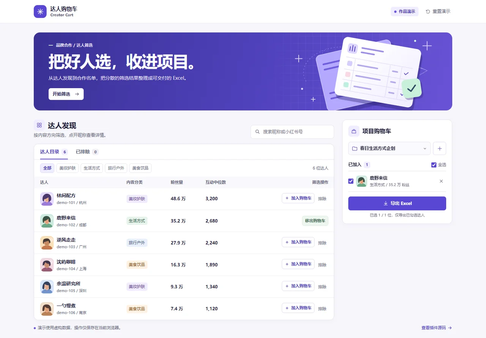

# 蒲公英达人购物车

Chrome / Edge Manifest V3 测试版插件。在蒲公英页面中按“小红书号”收藏达人，支持多项目购物车、本机持久化和 Excel 导出。

## 交互演示

**[打开达人购物车 · 作品演示](https://contt99.github.io/pgy-creator-cart/prototype/)** · 无需安装插件或登录蒲公英。也可下载仓库后，用 Chrome 或 Edge 打开 `prototype/index.html`。



1. 在「达人发现」点 **美妆护肤**，再点 **林间配方**，查看报价和粉丝画像。
2. 点 **加入购物车**，把人选加入「春日生活方式企划」。可以切换项目，或将暂不考虑的达人排除后恢复。
3. 在购物车保留要交付的勾选项，点 **导出 Excel**。工作簿包含「达人主表」「字段明细」「导出说明」。

**作品中的产品决策：** 目录保留浏览和筛选上下文，项目购物车单独管理候选与导出范围；排除状态按项目保存，便于继续筛选；导出只读取勾选项，复用插件的 XLSX 生成逻辑。

演示使用虚构数据，使用浏览器的本地存储，和插件的数据分开。页面不访问蒲公英，也不演示插件中的真实页面采集与批量更新。右上角的「重置演示」可恢复初始项目。

## 当前版本

- 版本：0.3.16
- 适配域名：`https://pgy.xiaohongshu.com/*`
- 唯一标识：红书号结合稳定的蒲公英达人 ID；列表与详情通过稳定 ID 关联，同名达人不会合并。
- 持久化：使用浏览器扩展本地存储，关闭或重启浏览器不会清空

## 安装

1. 克隆本仓库或下载 GitHub 的 **Code → Download ZIP** 后解压。若使用脚本生成的插件包，解压 `pgy-creator-cart-extension-v0.3.16.zip`。
2. Chrome 打开 `chrome://extensions/`，Edge 打开 `edge://extensions/`。
3. 开启“开发者模式”。
4. 点击“加载已解压的扩展程序”。
5. 选择包含 `manifest.json` 的文件夹（仓库根目录或解压的插件包目录）。
6. 刷新已经打开的蒲公英页面。

## 使用

1. 点击浏览器工具栏中的扩展图标，新建或切换项目。
2. 在蒲公英页面侧边点击“＋ / 加入”按钮，将当前显示的达人加入购物车。购物车条目会显示达人名、小红书号、粉丝量和“获赞与收藏”；点击达人名可在新标签页打开其蒲公英主页。
3. 通过任意入口进入蒲公英达人主页，只要该达人存在于一个或多个购物车项目，就会自动补充所有相关项目中的粉丝画像、内容表现和报价等已加载指标，并提示“已自动更新”。详情页打开后的两分钟内继续补充延迟加载内容；也可手动点击“更新本页已添加达人”。空值不会覆盖已有有效数据，已移除或排除的达人不会被自动加回。
4. 点击页面侧边的“购物车”按钮，可勾选、移除、更新当前页面数据或清空当前项目；按钮右上角会显示当前项目的达人数量。每位达人显示首次添加时间；成功从主页补全后另行显示主页更新时间。排除名单显示精确到秒的排除时间，全部使用本地时区和 `YYYY-MM-DD HH:mm:ss` 格式。
5. 点击“下载 Excel”，会导出当前项目中勾选的达人。

### 批量更新资料

- 页面购物车提供“批量更新资料”，可选择“资料缺失或超过 7 天”“当前项目全部达人”或“购物车中已勾选达人”。
- 每次最多处理 50 位达人，只复用一个更新标签页并逐位访问，不会同时打开大量主页。
- 每位达人之间随机等待 4–7 秒；每完成 10 位额外暂停 15–25 秒，以兼顾速度和页面请求频率。
- 任务显示成功、失败、跳过和当前进度，支持暂停、继续、取消。进度保存在浏览器本机，更新标签页意外关闭后仍可继续。
- 更新期间，蒲公英列表页和达人主页都会显示悬浮进度条与控制按钮。手动关闭更新标签页后，任务会自动切换为“已中断”，并显示“继续”按钮。
- 队列进度与成功数量通过同一次带达人身份校验的操作更新；详情页重复触发保存时不会重复累计成功数。
- 当前达人主页 60 秒内无法读取有效数据时，任务会因异常暂停，不会持续刷新。已排除达人不进入更新队列。

同一个小红书号在同一项目中只会保留一条记录；可以同时存在于不同项目。

## Excel 内容

- `达人主表`：达人名、小红书号、所属机构、粉丝量、赞藏量、内容类别、达人标签、主页链接、蒲公英链接、曝光/阅读/互动中位数、图文/视频笔记一口价、粉丝性别占比、粉丝地域分布、5 个年龄段占比、达人所在地，以及首次加入/最后更新时间。
- `字段明细`：把每个采集字段拆成独立行，便于筛选和核查。
- `导出说明`：导出时间、项目、达人数量、唯一键和数据范围。

## 首版数据范围

插件会保存达人加入或点击“更新本页已添加达人”时，当前登录账号在页面中可见且能读取的数据。列表页通常只能提供部分指标；粉丝画像、详细内容表现和报价建议进入达人详情页后更新。页面未提供或仅绘制在不可读取画布中的字段会留空，插件不会绕过蒲公英权限获取数据。

如果目标页面未出现“加入购物车”按钮，请提供：

- 当时的蒲公英页面 URL（不要提供登录凭证或 Cookie）；
- “小红书号”所在达人卡片的 HTML 片段或开发者工具截图。

## 本地开发检查

目录分工：`src/content/` 对接蒲公英页面，`src/popup/` 是浏览器扩展弹窗，`src/shared/` 提供项目存储、筛选列表和 Excel 导出，`prototype/` 是独立网页演示。

```powershell
node --test tests/*.test.cjs
```

已安装 Chrome 时，可以运行演示的交互和下载测试：

```powershell
npm install --no-save --no-package-lock playwright
node tests/prototype-browser.cjs
```

生成测试包：

```powershell
powershell -ExecutionPolicy Bypass -File scripts/build.ps1
```

## 项目筛选记忆（0.3.1）

- 笔记博主广场底部悬浮条直接提供“本页筛选完成”、撤销、隐藏开关和当前项目统计；每行左下角提供“加入购物车／排除”或当前状态。控件不增加表格行高，不改列宽。
- “本页筛选完成”仅处理当前加载列表，保留当前项目已添加达人。不会自动翻页或跨页补齐。存在无法可靠识别的行时，整页批量操作暂停并显示数量。
- 详情页侧边提供“排除此人／恢复达人”；已添加达人不允许从详情页误排除，需在购物车明确选择“移除并排除”。
- 排除记录默认标记。可开启“隐藏已排除达人（保留占位）”：隐藏内容但保留原卡片高度，避免影响分页和虚拟列表滚动布局。关闭后恢复显示。
- 购物车及排除名单均支持昵称、小红书号的部分匹配搜索，忽略英文大小写。搜索不影响本页筛选的范围。两个列表分别保留本次打开期间的搜索内容。
- 排除名单支持单个/勾选批量恢复、撤销最近一次本页筛选。搜索变化会清除排除名单勾选。点击达人昵称可在新标签页直达蒲公英主页；批量恢复和导出按钮固定在名单滚动区域之外。
- 排除名单底部操作栏右侧提供全选；搜索时只选择当前搜索结果，并显示全选、部分选择和未选择状态。购物车与排除名单在状态提示下方使用一致的列表分隔线。
- 排除名单按排除时间倒序显示，最近排除的达人位于最上方；排除时间相同时保持原有顺序。
- 购物车与排除名单使用统一的三列达人行、信息层级、间距、分隔线、按钮样式和空状态；昵称默认无下划线，悬停或键盘聚焦时变红。
- 0.3.16 统一抽屉与扩展弹窗中两类列表的分隔线颜色、昵称字号、信息文字颜色与间距、操作栏内边距；已排除页只保留页脚的一条底部分隔线，避免双边框叠加变深。
- “移除并排除”记录筛选结果；普通移除不记录。加入购物车会解除排除。
- 排除名单可导出 Excel，包含昵称、小红书号、项目、UTC 排除时间和来源；导出全部排除记录，不受搜索影响。
- 排除记录和隐藏开关按项目保存。清空购物车保留排除名单，删除项目会一并删除。历史移除记录无法追溯。
- 更新时请覆盖原已加载扩展目录中的文件，再到扩展管理页重新加载并刷新蒲公英，保留原扩展 ID 和本地数据；不要先卸载旧扩展。
- 已在 2026-09-12 的真实笔记博主广场验证 20 人列表识别、已添加保护、隐藏占位、原生翻页、返回恢复、昵称与红书号搜索及详情页状态同步。平台自身推荐顺序可能随时间变化；插件不更改原生排序或分页请求。其他列表样式、未来页面变更仍可能需要适配。
- 页面未提供红书号时不伪造；以稳定 ID 记录并显示“待详情页补充”。列表页只保存已有基础指标，从购物车打开详情页自动补充已加载详情数据。没有新增独立数据看板。
- 自动更新不依赖进入主页的来源，会更新所有包含该达人的购物车项目。购物车显示“已从主页更新”，代表已保存当前可读取数据，不代表所有指标均已提供。
- 购物车底部支持全选或取消选择当前搜索结果，并同时显示已选数量与当前显示数量；搜索不会悄悄改变其他达人选中状态。
- 单个“移除”和“移除并排除”提供 6.5 秒撤销入口，撤销会恢复达人原有顺序、添加时间和已采集数据。
- 抽屉支持 `Esc` 关闭、键盘焦点约束和关闭后焦点返回；达人昵称使用一致的红色键盘焦点样式。
- 页面抽屉和扩展弹窗均可下载完整 JSON 备份或恢复备份。恢复前会自动下载当前数据，备份包含全部项目、购物车、排除记录和批量任务状态。
- 列表身份与详情数据共用一次页面 JSON 响应解析；滚动时只更新当前位置相关控件，详情页仍每 2 秒补充延迟加载数据，完整列表扫描降为 10 秒兜底。
- 购物车与排除名单的底部操作栏固定使用相同高度、按钮尺寸、间距和内边距；备份文件输入框始终隐藏，点击“恢复备份”直接打开系统文件选择窗口。
